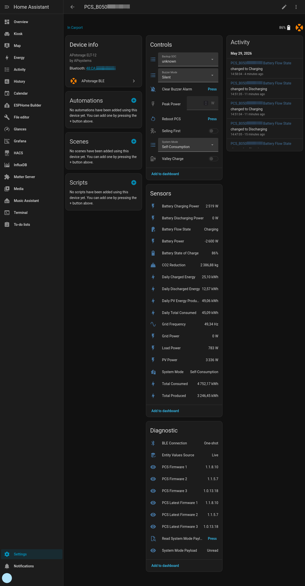

# APstorage BLE — Home Assistant Custom Integration

A Home Assistant custom integration for the **APsystems APstorage ELT-12 PCS** communicating over **Bluetooth Low Energy (BLE)**.

> **AI authorship notice:** This integration was written by AI (GitHub Copilot).

Compatibility note:
- Fully tested on **ELT-12**.
- **ELS-11.4** and **ELS-5K** may also work (autodiscovery and model mapping are implemented), but they have **not been tested** yet.

Designed to work with an **ESPHome Bluetooth proxy** placed near the PCS.

---

## Screenshot



---

## Status

Most core integration features are working in day-to-day use on ELT-12.

| Component | Status |
|---|---|
| HA integration structure | ✅ Complete |
| Config flow (auto-discover + manual MAC) | ✅ Complete |
| BLE client (BluFi custom data + app-layer AES, no BluFi security) | ✅ Rewritten in 2.0 |
| Polling (one short connection per poll) | ✅ Rewritten in 2.0 |
| Sensor entity platform | ✅ **Working** |
| System mode select (write) | ✅ **Working** |
| Buzzer mode select (write) | ✅ **Working** |
| Clear buzzer alarm (button/service) | ✅ **Working** |
| PCS reboot (button/service) | ✅ **Working** |
| Peak Valley schedule service (mode 0) | ✅ **Working** |
| sellingFirst/valleycharge/peakPower services | ✅ **Working** |
| Service call for mode changes | ✅ **Working** |

---

## Entities Created

The integration creates the following entities.

#### Battery
- Battery State of Charge (`%`)
- Battery Power (`W`, positive = discharging, negative = charging)
- Battery Discharging Power (`W`)
- Battery Charging Power (`W`)
- Daily Charged Energy (`kWh`)
- Daily Discharged Energy (`kWh`)
- Battery Flow State (`enum`: Charging, Discharging, Holding)
- Battery Capacity (`kWh`, diagnostic)
- Minimum SOC (`%`, diagnostic)
- Backup SOC Level (`%`, diagnostic)

#### PV / Solar
- PV Power (`W`)
- Daily PV Energy Produced (`kWh`)

#### Grid
- Grid Power (`W`, positive = import, negative = export)
- Grid Import Power (`W`)
- Grid Export Power (`W`)
- Daily Grid Import (`kWh`)
- Daily Grid Export (`kWh`)
- Grid Frequency (`Hz`, when the PCS reports it)
- Grid Status (`enum`: On-grid, Off-grid)
- Generator Power (`W`, disabled by default)

#### Load / Output
- Load Power (`W`)
- Daily Total Consumed (`kWh`)

#### System
- System Mode (`enum`)
- Buzzer Alarm (`enum`: Active, None)
- CO2 Reduction (`kg`)
- Total Produced (`kWh`)
- Total Consumed (`kWh`)

#### Diagnostics
- PCS Firmware 1 / 2 / 3 (module versions)
- Communication Module Firmware
- Cloud Connection
- Price Area
- Wi-Fi Network, Wi-Fi Signal, Wi-Fi IP Address (disabled by default)
- System Mode Payload (last `getsysmode` read)
- Last Update, Connection Quality, BLE MTU (disabled by default)

#### Controls
- System Mode (`select` entity)
    - Peak Valley
    - Self-Consumption
    - Manual Control
    - Advanced
    - Backup power supply
    - Peak-Shaving
    - Intelligent
- Backup SOC (`select` entity)
- Buzzer Mode (`select` entity)
    - Silent
    - Normal
- Selling First (`switch` entity)
- Valley Charge (`switch` entity)
- Peak Power (`number` entity, mode 5 only)
- Clear Buzzer Alarm (`button` entity)
- Reboot PCS (`button` entity)

Service:
- `apstorage_ble.set_system_mode`
    - `mode`: required (`0..6` or mode label)
    - `entry_id`: optional (target config entry)
    - `address`: optional (target device MAC)
- `apstorage_ble.get_system_mode_payload`
    - reads current `getsysmode` payload from battery over BLE
    - fires event `apstorage_ble_system_mode_payload` with fields:
      `address`, `storage_id`, `code`, `message`, `payload`
    - `entry_id`: optional (target config entry)
    - `address`: optional (target device MAC)
- `apstorage_ble.set_peak_valley_schedule`
    - `peak_time`: optional (`HH:MM-HH:MM` or `HHMMSSHHMMSS`, max 5)
    - `valley_time`: optional (`HH:MM-HH:MM` or `HHMMSSHHMMSS`, max 5)
    - at least one of `peak_time` / `valley_time` is required
    - `entry_id`: optional (target config entry)
    - `address`: optional (target device MAC)
- `apstorage_ble.set_advanced_schedule`
    - `schedule`: optional list of windows with `startTime`, `endTime`, and `mode` (`charge` or `discharge`)
    - `peak_time`: optional legacy peak/discharge ranges (`HH:MM-HH:MM` or `HHMMSSHHMMSS`, max 5)
    - `valley_time`: optional legacy valley/charge ranges (`HH:MM-HH:MM` or `HHMMSSHHMMSS`, max 5)
    - `entry_id`: optional (target config entry)
    - `address`: optional (target device MAC)
- `apstorage_ble.set_buzzer_mode`
    - `buzzer_mode`: required (`0/1` or label `Silent/Normal`)
    - `entry_id`: optional (target config entry)
    - `address`: optional (target device MAC)
- `apstorage_ble.clear_buzzer`
    - `entry_id`: optional (target config entry)
    - `address`: optional (target device MAC)
- `apstorage_ble.reboot_pcs`
    - `entry_id`: optional (target config entry)
    - `address`: optional (target device MAC)
- `apstorage_ble.set_selling_first`
    - `enabled`: required (`true/false`)
    - `entry_id`: optional (target config entry)
    - `address`: optional (target device MAC)
- `apstorage_ble.set_valley_charge`
    - `enabled`: required (`true/false`)
    - `entry_id`: optional (target config entry)
    - `address`: optional (target device MAC)
- `apstorage_ble.set_peak_power`
    - `peak_power`: required (`100..50000`, mode 5 only)
    - `entry_id`: optional (target config entry)
    - `address`: optional (target device MAC)

---

## Installation

### Via HACS (recommended)

[](https://my.home-assistant.io/redirect/hacs_repository/?owner=albatorsk&repository=apstorage-ble&category=integration)

1. Add this repository as a custom repository in HACS using the Integration category.
2. Install "APstorage BLE".
3. Restart Home Assistant.

### Manual

1. Copy `custom_components/apstorage_ble/` into your HA `config/custom_components/` directory.
2. Restart Home Assistant.

---

## Setup

1. Make sure your ESPHome Bluetooth proxy is configured and connected to HA.
2. Power on the PCS (`PCS_B050XXXXXXXX`, MAC `AA:BB:CC:DD:EE:FF`).
3. In HA go to **Settings → Devices & Services**.
4. The PCS should be auto-discovered.  Click **Configure** and confirm.
5. If not auto-discovered, click **Add Integration**, search for **APstorage BLE**, and enter the MAC address manually.
6. Setup finishes once the first poll has read the PCS, so all entities have values right away.

---

## Protocol Notes

The BLE client follows the protocol in `APSTORAGE_BLE_SPEC.md`, verified on an ELT-12 (firmware dcmVer 0.1.66.0):
Espressif BluFi custom-data frames on service `0xFFEC` (write `0xFF07`, notify `0xFF06`), without BluFi
security negotiation, carrying JSON encrypted with the app's static AES-128-CBC key.

Each poll opens one connection, sends `getDeviceLastDataLocal` and `getsysmode` (plus `deviceInfo` on the
first poll and every 6 hours), and disconnects, so the phone app can connect between polls. A failed poll
keeps the last values; entities become unavailable after 3 failed polls in a row. Settings changes read
`getsysmode`, change only the requested fields, write `setsysmode` and read the result back.

To see the raw traffic, enable debug logging for `custom_components.apstorage_ble`.

---

## Device info

| Field | Value |
|---|---|
| Device name | `PCS_B050XXXXXXXX` |
| Bluetooth MAC | `AA:BB:CC:DD:EE:FF` |
| Protocol | BLE GATT (custom service) |
| Connection | One short connection per poll (every 30 s by default) |

---

## Architecture

```
custom_components/apstorage_ble/
├── __init__.py        # Entry setup / teardown
├── manifest.json      # Integration metadata & BLE matchers
├── const.py           # Constants, model lookup
├── config_flow.py     # Auto-discovery + manual MAC entry
├── coordinator.py     # Polling and write commands (DataUpdateCoordinator)
├── pcs_client.py      # BLE client: BluFi framing, AES, request/reply
├── models.py          # PCSData and reply parsing
├── protocol.py        # Operating-mode helpers
├── sensor.py / select.py / switch.py / number.py / button.py
├── strings.json       # UI strings
├── services.yaml      # Service definitions
└── translations/
    └── en.json
```

---

